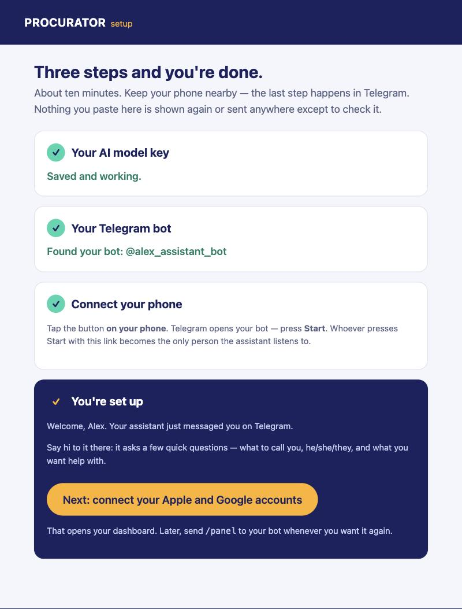
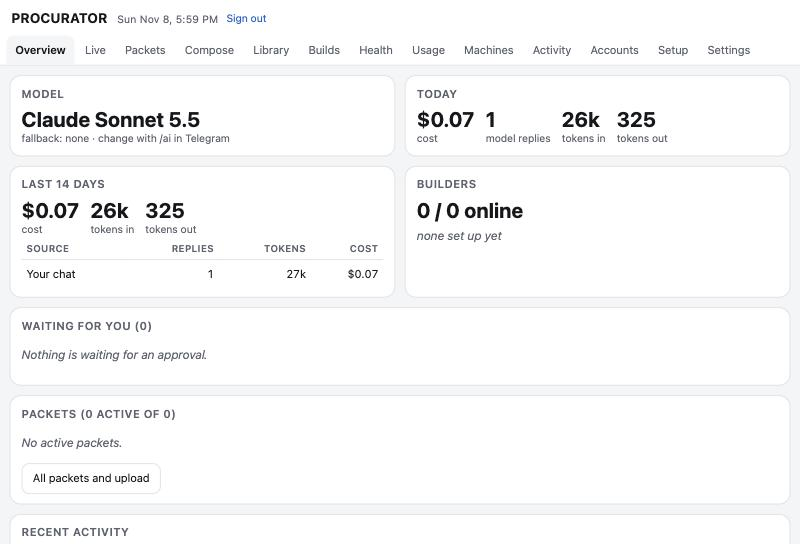
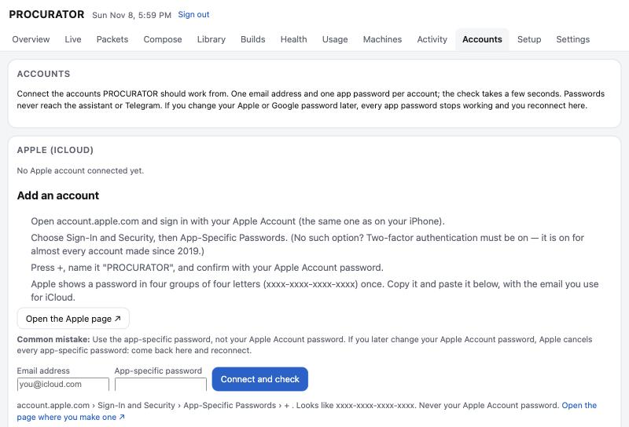
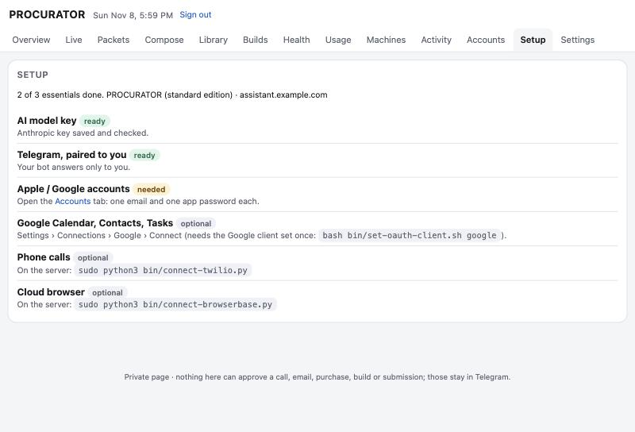

# PROCURATOR

**Your admin, done. Nothing sent without you.**

PROCURATOR is a self-hosted autonomous administrative agent for professionals. It reads and drafts your mail, keeps your calendar, phones businesses and agencies, fills in web forms on public and signed-in sites, runs long multi-step projects from task packets, and reports to you in Telegram. Anything that leaves your hands — an email, a text, a form submission, a purchase, a phone call — comes back to your phone first as an exact receipt, bound to a hash of the content, and runs only after you tap approve.

It runs on **your own server** (a $12–24/month Ubuntu box) with **your own model keys**, on top of the open-source [OpenClaw](https://github.com/openclaw) gateway. No PROCURATOR cloud, no training on your data, no shared account.

> **Status:** early public release (0.30.0). The safety kernel and its ~1,000 tests are mature; the installer and the Mac companion are new. Health features are logistics only (appointments, refills, portal paperwork), never medical advice. Not yet independently audited — see [SECURITY.md](SECURITY.md).

## What it looks like

Captured on a fresh test server right after a first install (names changed).

| Setup: one page, three steps | Dashboard overview |
|---|---|
|  |  |
| **Accounts: one app password each** | **Setup checklist** |
|  |  |

## Two editions, one tree

| | **PROCURATOR** (standard) | **PROCURATOR-X** (developer) |
|---|---|---|
| For | Professionals who want an assistant | Developers who also want a coding orchestrator |
| Mail, calendar, contacts, phone, web errands, task packets, research, health logistics, dashboard | ✓ | ✓ |
| Code builds: task packets become **draft pull requests** on your own Mac/PC (Claude Code or Codex), `/buildapprove` | — | ✓ |
| Builder relay, Composer "coding" packets, Builds tab | — | ✓ |
| Recommended box | 4 GB | 8 GB |
| Install | `install.sh` | `install.sh --edition x` |

The edition is a switch, not a fork: one codebase, one version. On a standard box the orchestrator's connector (`builds`) is absent from the policy, so its tools refuse by design and the model is never told about them. Switch later by re-running the installer.

## What it does

- **Approvals, by design.** Six risk classes (`read`, `draft`, `own_write`, `owner`, `external`, `public`); every external action is a native Telegram command (`/mailsend`, `/callapprove`, `/webtask`, `/smssend`, `/buildapprove`, …) carrying a hash of the exact content. A changed draft needs a new approval. A never-list (payments beyond your cap, new accounts, anything to unknown numbers) is enforced in code, not prompts.
- **Email** (Gmail + iCloud): read, search, draft, send after approval, your Bcc on everything it sends.
- **Calendar, contacts, tasks**: Google and Apple (CalDAV/CardDAV with an app-specific password — no developer account needed).
- **Phone calls** (Twilio + realtime voice): approved calls to businesses and agencies, automated-menu navigation, listen-in where you merge into the call.
- **Web errands**: cloud browser or your own home PC, per-site rules, signed-in sites with logins you perform yourself, one approval per task, no double submits.
- **Task packets (missions)**: Markdown packets for long projects, with evidence, journals, questions and deadlines — and a Composer that writes them with you.
- **Research**: web, news, quotes, PubMed/Europe PMC/ClinicalTrials.gov, whole-document reading.
- **Health logistics** (optional module, off by default): appointment and refill errands, portal paperwork, under explicit grants; labeled health values never leave to an unlisted recipient.
- **Dashboard**: overview, packets, usage meter, accounts, connections, live browser view, approvals practice.
- **Any model, visible meter**: Anthropic, OpenAI or others per task family; `/ai` switches, `/meter` shows spend.

Counted from the code: **180 model tools** across **36 connector manifests**, **97 owner commands**, **133 test files**.

## Install

Three things, about 20 minutes, no terminal skills needed:

1. **Rent an Ubuntu 24.04 server** (e.g. a $24/month 4 GB DigitalOcean droplet; 8 GB for PROCURATOR-X).
2. **Paste one line** into its console:
   ```bash
   curl -fsSL https://raw.githubusercontent.com/Primaris-Research-Group/procurator/main/bin/install.sh | sudo bash -s -- \
     --repo https://github.com/Primaris-Research-Group/procurator.git            # add --edition x for PROCURATOR-X
   ```
   It installs everything, turns on HTTPS (on your domain with `--domain`, or a free `<ip>.sslip.io` name), and prints a **one-time setup link**.
3. **Open the link.** Paste your Anthropic key, paste the token @BotFather gives you, then tap **Open my bot** on your phone and press **Start**. That's the pairing: no codes, no user ids. The page then hands you to the dashboard's **Accounts** tab, where iCloud and Gmail connect with one app password each, with step-by-step guidance.

Prefer a terminal? `sudo python3 bin/connect-accounts.py` does the same three steps with hidden input. Full guide: [docs/install.md](docs/install.md). A Mac app that also rents the server for you is in development ([docs/roadmap.md](docs/roadmap.md)).

## Layout

```
bin/            installer, operator scripts (connect-*, set-*, test-deployment)
integrations/
  web/          web broker (Python, stdlib): dashboard, browser, packets, accounts, connectors, health
  web-plugin/   OpenClaw plugin: tools and Telegram commands for the web broker
  mail/ mail-plugin/   mail broker + plugin (Gmail, iCloud)
  voice/ voice-plugin/ voice-http/   phone calls
  builder/      PROCURATOR-X: build worker that runs on your Mac/PC
  browser-worker/      home-PC browser lane
  apple-health/ google-output/ icloud-relay/   optional companions
compose.yaml    entry point: includes compose.upstream.yaml (OpenClaw's own file, pinned image),
                compose.private.yaml (this project's local overrides: loopback ports, memory limits, health check)
                and compose.google.yaml; compose.web/mail/voice.yaml add the broker sockets for each module
site/           the project website
docs/           install, editions, security model, API and manifest specs
```

## Safety model in five lines

1. The model never holds a credential; brokers do, as root, behind two Unix sockets (`tools.sock` for the model, `approval.sock` for owner commands).
2. Every tool is declared in a manifest with a risk class; undeclared tools refuse (deny by default).
3. Every external action is approved in Telegram with a content hash; the approval is useless for anything else.
4. Health values are labeled at the source and checked at every exit.
5. Everything is logged to an activity ledger you can read in the dashboard.

Details: [docs/security-model.md](docs/security-model.md).

## Contributing and licence

Issues and pull requests are welcome — see [CONTRIBUTING.md](CONTRIBUTING.md). Report vulnerabilities privately as described in [SECURITY.md](SECURITY.md).

Apache License 2.0 — see [LICENSE](LICENSE) and [NOTICE](NOTICE). OpenClaw is MIT-licensed (`licenses/`).

PROCURATOR is a project of Primaris Health Institute, a medical AI research non-profit. Physicians interested in the research programme: see the website's recruitment section.
